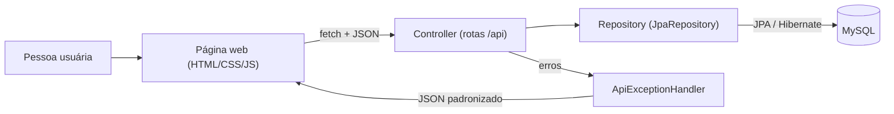
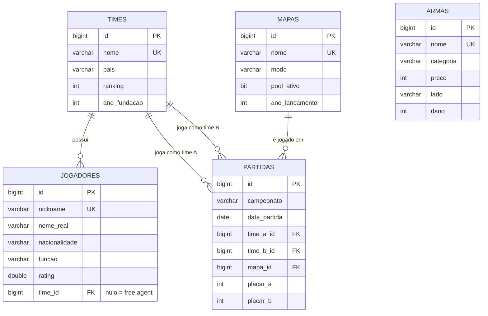

# CS Hub — Gestão de campeonatos de Counter-Strike

Aplicação web com **API REST em Spring Boot** e **página em HTML, CSS e JavaScript** para organizar o cenário competitivo de Counter-Strike: times, jogadores, partidas, mapas e armas. Os dados ficam salvos em **MySQL**.

---

## 1. Problema e público

Organizadores de campeonatos amadores, ligas universitárias e lan houses costumam controlar inscrições de times, elencos e resultados em planilhas soltas ou grupos de mensagem. Isso gera informações duplicadas, placares perdidos e retrabalho na hora de montar tabelas.

O **CS Hub** centraliza essas informações em um único sistema.

**Quem usa:** a pessoa organizadora do campeonato (ou a equipe de staff), que cadastra os times participantes, os elencos, registra os resultados das partidas e mantém a lista de mapas e armas usada nas regras do torneio.

### Funcionalidades

| Área | O que é possível fazer |
|---|---|
| **Times** | Cadastrar, listar (ordenado pelo ranking), editar e excluir equipes |
| **Jogadores** | Cadastrar jogadores com função e rating, vincular a um time ou deixar como *free agent* |
| **Partidas** | Registrar confrontos entre dois times, em um mapa, com placar e campeonato |
| **Mapas** | Manter o pool de mapas e indicar quais estão ativos no campeonato |
| **Armas** | Manter a tabela de armas, preço, lado (TR/CT) e dano |
| **Geral** | Filtro rápido na lista, mensagens de sucesso/erro, confirmação antes de excluir, layout para celular |

### Regras de negócio

- Nome de time, nickname de jogador, nome de mapa e nome de arma são **únicos** (retorna `409`).
- Função do jogador: `AWPer`, `Entry`, `IGL`, `Suporte`, `Lurker` ou `Rifler`. Rating entre `0.0` e `3.0`.
- Modo do mapa: `Competitivo`, `Wingman` ou `Casual`.
- Categoria da arma: `Pistola`, `SMG`, `Rifle`, `Sniper` ou `Pesada`; lado: `TR`, `CT` ou `Ambos`; preço entre `0` e `10000`.
- Uma partida exige **dois times diferentes** e um mapa existente; placar entre `0` e `50`.
- Um time **não pode ser excluído** se tiver jogadores ou partidas vinculadas; um mapa não pode ser excluído se estiver em partidas (`409`).

---

## 2. Tecnologias

- **Java 17+** e **Spring Boot 3.5** (Spring Web, Spring Data JPA, Validation)
- **MySQL 8** (driver `mysql-connector-j`)
- **springdoc-openapi** (Swagger UI)
- **JUnit 5 + MockMvc + H2** (testes automatizados com banco em memória)
- **HTML5, CSS3 e JavaScript** puro (sem frameworks), consumindo a API com `fetch`
- **Maven** (com Maven Wrapper incluso — não precisa instalar o Maven)

---

## 3. Estrutura do projeto

```
api-rest/
├── docs/
│   ├── banco/
│   │   ├── schema.sql            # script de criação das tabelas
│   │   └── dados-iniciais.sql    # dados de exemplo (opcional)
│   ├── evidencias/               # resultado da execução dos testes
│   ├── API.md                    # documentação detalhada dos endpoints
│   ├── APRESENTACAO.md           # roteiro da demonstração
│   └── openapi.json              # especificação OpenAPI gerada pela API
├── src/main/java/br/com/cshub/
│   ├── CsHubApplication.java     # classe principal
│   ├── config/                   # Swagger, CORS, tratamento de erros, dados iniciais
│   ├── controller/               # rotas REST (GET, POST, PUT, DELETE)
│   ├── entity/                   # entidades JPA (tabelas)
│   └── repository/               # interfaces JpaRepository (acesso a dados)
├── src/main/resources/
│   ├── application.properties    # configurações (lê variáveis de ambiente)
│   └── static/                   # página web
│       ├── index.html
│       ├── css/style.css
│       └── js/ (api.js, entidades.js, app.js)
├── src/test/                     # testes automatizados
├── .env.example                  # modelo das variáveis de ambiente
├── mvnw / mvnw.cmd               # Maven Wrapper
└── pom.xml
```

**Fluxo da aplicação:**



---

## 4. Pré-requisitos

- **JDK 17 ou superior** (testado com JDK 17 e 25)
- **MySQL 8** rodando localmente (ou em container)
- **Git**

> O Maven não precisa estar instalado: use `mvnw.cmd` (Windows) ou `./mvnw` (Linux/macOS).

---

## 5. Instalação e execução

### 5.1 Clonar o repositório

```bash
git clone <URL_DO_REPOSITORIO>
cd api-rest
```

### 5.2 Configurar o banco de dados

A aplicação cria o banco `cs_hub` e todas as tabelas automaticamente na primeira execução (`createDatabaseIfNotExist=true` + `ddl-auto=update`). Basta ter um usuário MySQL com permissão.

Se preferir criar manualmente, execute o script:

```bash
mysql -u root -p < docs/banco/schema.sql
```

Na primeira execução com o banco vazio, a classe `config/DadosIniciais` insere times, jogadores, mapas, armas e partidas de exemplo. (O script `docs/banco/dados-iniciais.sql` tem os mesmos dados, caso queira inserir manualmente.)

### 5.3 Configurar as variáveis de ambiente

Nenhuma senha fica no código. Copie o arquivo de exemplo e preencha com os seus dados:

```bash
# Windows (PowerShell)
Copy-Item .env.example .env

# Linux/macOS
cp .env.example .env
```

| Variável | Descrição | Padrão |
|---|---|---|
| `DB_URL` | URL JDBC do MySQL | `jdbc:mysql://localhost:3306/cs_hub?createDatabaseIfNotExist=true&...` |
| `DB_USER` | Usuário do banco | `root` |
| `DB_PASSWORD` | Senha do banco | *(vazio)* |
| `SERVER_PORT` | Porta da aplicação | `8080` |

O arquivo `.env` é lido automaticamente pelo Spring (`spring.config.import`) e está no `.gitignore`. Também é possível definir as variáveis direto no sistema operacional ou na IDE.

### 5.4 Executar

```bash
# Windows
mvnw.cmd spring-boot:run

# Linux/macOS
./mvnw spring-boot:run
```

Ou gerar o `.jar` e executar:

```bash
mvnw.cmd clean package
java -jar target/cs-hub-1.0.0.jar
```

Depois acesse:

| O quê | Endereço |
|---|---|
| Página web | http://localhost:8080 |
| Swagger UI | http://localhost:8080/swagger-ui.html |
| OpenAPI (JSON) | http://localhost:8080/v3/api-docs |

---

## 6. API — resumo dos endpoints

**Endereço base:** `http://localhost:8080/api`

Todas as entidades seguem o mesmo padrão:

| Método | Rota | Descrição | Sucesso |
|---|---|---|---|
| `GET` | `/api/{recurso}` | Lista todos os registros | `200` |
| `GET` | `/api/{recurso}/{id}` | Consulta por ID | `200` |
| `POST` | `/api/{recurso}` | Cadastra um registro | `201` |
| `PUT` | `/api/{recurso}/{id}` | Atualiza um registro | `200` |
| `DELETE` | `/api/{recurso}/{id}` | Remove um registro | `204` |

Recursos disponíveis: `times`, `jogadores`, `partidas`, `mapas`, `armas`.

**Códigos de erro:**

| Código | Quando acontece |
|---|---|
| `400 Bad Request` | Campos inválidos, JSON mal formatado, ID não numérico, relacionamento inexistente |
| `404 Not Found` | Registro ou rota não encontrada |
| `409 Conflict` | Nome duplicado ou exclusão de registro em uso |
| `500 Internal Server Error` | Erro inesperado no servidor |

Exemplo de resposta de validação:

```json
{
  "timestamp": "2026-11-24T11:40:12.315",
  "status": 400,
  "erro": "Bad Request",
  "mensagem": "Existem campos inválidos. Verifique os dados enviados.",
  "campos": {
    "nome": "O nome do time é obrigatório",
    "ranking": "O ranking deve ser maior ou igual a 1"
  }
}
```

A documentação completa, com todos os campos e exemplos de requisição/resposta, está em **[docs/API.md](docs/API.md)** e no **Swagger UI**. A especificação OpenAPI está em [docs/openapi.json](docs/openapi.json) (pode ser importada no Postman ou Insomnia).

---

## 7. Modelo do banco de dados



Script de criação: [docs/banco/schema.sql](docs/banco/schema.sql).

---

## 8. Testes

Os testes automatizados usam **JUnit 5 + MockMvc** e um banco **H2 em memória** — não é preciso ter o MySQL rodando para executá-los. Cobrem listagem, consulta por ID, cadastro, atualização, exclusão, validações (`400`), recurso inexistente (`404`) e conflitos (`409`) das cinco entidades.

```bash
# Windows
mvnw.cmd test

# Linux/macOS
./mvnw test
```

Os relatórios ficam em `target/surefire-reports/`. A evidência da última execução está em [docs/evidencias/resultado-testes.txt](docs/evidencias/resultado-testes.txt).

Para testar manualmente, use o **Swagger UI** (botão *Try it out*) ou importe o arquivo `docs/openapi.json` no Postman/Insomnia (*Import → File*).

---

## 9. Organização do código

| Pasta | Responsabilidade |
|---|---|
| `entity` | Classes mapeadas com `@Entity`, `@Id` e `@GeneratedValue(strategy = GenerationType.IDENTITY)`. Cada uma tem três construtores (vazio, completo e sem ID), getters e setters, e as regras de validação nos atributos. |
| `repository` | Interfaces que estendem `JpaRepository<Entidade, Long>`, com consultas derivadas para checar duplicidade e vínculos. |
| `controller` | Rotas REST centralizadas com `@RequestMapping("/api/...")` e métodos `@GetMapping`, `@PostMapping`, `@PutMapping` e `@DeleteMapping`, usando os métodos do JPA (`findAll`, `findById`, `save`, `deleteById`, `existsById`). |
| `config` | `SwaggerConfig` (documentação), `WebConfig` (CORS), `ApiExceptionHandler` (respostas de erro padronizadas) e `DadosIniciais` (carga inicial). |

---

## 10. Histórico do Git

O desenvolvimento foi registrado com commits semânticos (`feat:`, `fix:`, `docs:`, `test:`, `chore:`, `refactor:`). Para ver:

```bash
git log --oneline
```

---

## 11. Créditos

- [Spring Boot](https://spring.io/projects/spring-boot) — framework da API (Apache 2.0)
- [springdoc-openapi](https://springdoc.org/) — geração do Swagger UI (Apache 2.0)
- [MySQL Connector/J](https://dev.mysql.com/downloads/connector/j/) — driver do banco
- [H2 Database](https://www.h2database.com/) — banco em memória para testes
- *Counter-Strike* é marca registrada da Valve Corporation. Este é um projeto acadêmico, sem fins comerciais e sem vínculo com a Valve. Nomes de times e jogadores são usados apenas como dados de exemplo.
- Nenhuma imagem ou fonte externa foi utilizada na interface.
