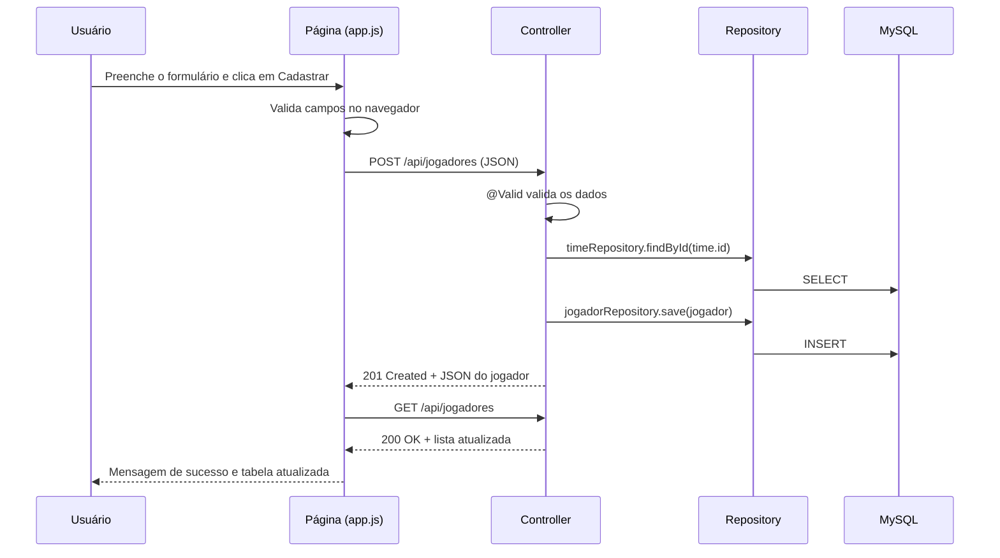

# Roteiro da apresentação — CS Hub

Tempo sugerido: 8 a 10 minutos.

## 1. Problema (1 min)

- Organizadores de campeonatos amadores de Counter-Strike controlam times, elencos e resultados em planilhas e grupos de mensagem.
- Problemas: dados duplicados, placares perdidos, ninguém sabe qual planilha é a mais recente.
- **Público:** a pessoa organizadora do campeonato e a equipe de staff.

## 2. Escopo e entidades (1 min)

| Entidade | Para que serve |
|---|---|
| Time | Equipes inscritas e seu ranking |
| Jogador | Elenco de cada time (ou *free agent*) |
| Partida | Resultado de um confronto entre dois times em um mapa |
| Mapa | Pool de mapas do campeonato |
| Arma | Tabela de armas e preços usada nas regras |

Relacionamentos: jogador → time (opcional); partida → time A, time B e mapa.

## 3. Decisões de projeto (2 min)

- **Spring Boot + JPA + MySQL:** o JPA gera as tabelas a partir das entidades e já traz os métodos de CRUD (`findAll`, `findById`, `save`, `deleteById`).
- **Camadas:** `entity` (modelo e validações) → `repository` (acesso a dados) → `controller` (rotas REST) → `config` (Swagger, CORS, erros e dados iniciais).
- **Validação com Bean Validation** nas entidades (`@NotBlank`, `@Min`, `@Pattern`...) e **tratamento centralizado de erros** (`ApiExceptionHandler`), garantindo mensagens claras em português e códigos HTTP corretos (400, 404, 409, 500).
- **Regras de integridade:** não é possível excluir um time com jogadores/partidas nem cadastrar uma partida de um time contra ele mesmo.
- **Segredos fora do código:** credenciais via variáveis de ambiente / arquivo `.env` (ignorado pelo Git).
- **Front-end sem framework:** HTML, CSS e JS separados; o JS é dirigido por configuração (`entidades.js`), então as cinco telas reaproveitam o mesmo código.

## 4. Fluxo interface → API → banco (1 min)

## 5. Demonstração ao vivo (3 min)

1. Abrir http://localhost:8080 e mostrar as abas com os dados iniciais.
2. **Cadastrar** um time (ex.: Imperial) → mensagem de sucesso, tabela atualiza sem recarregar.
3. Enviar o formulário **vazio** → mensagens de validação em cada campo.
4. **Editar** o time e salvar.
5. Cadastrar um **jogador** vinculado ao novo time.
6. Tentar **excluir a FURIA** → erro 409 (possui jogadores).
7. Registrar uma **partida** com o mesmo time nos dois lados → erro de validação.
8. Desligar a API e clicar em "Atualizar" → estado de **falha de conexão** com botão "Tentar novamente".
9. Reduzir a janela → layout responsivo (tabela vira cartões).
10. Abrir o **Swagger** (http://localhost:8080/swagger-ui.html) e executar um `GET /api/times/{id}`.

## 6. Qualidade (1 min)

- `mvnw.cmd test` → 31 testes automatizados (MockMvc + H2) passando.
- Documentação: README, `docs/API.md`, Swagger e `docs/openapi.json`.
- Histórico do Git com commits semânticos (`git log --oneline`).
